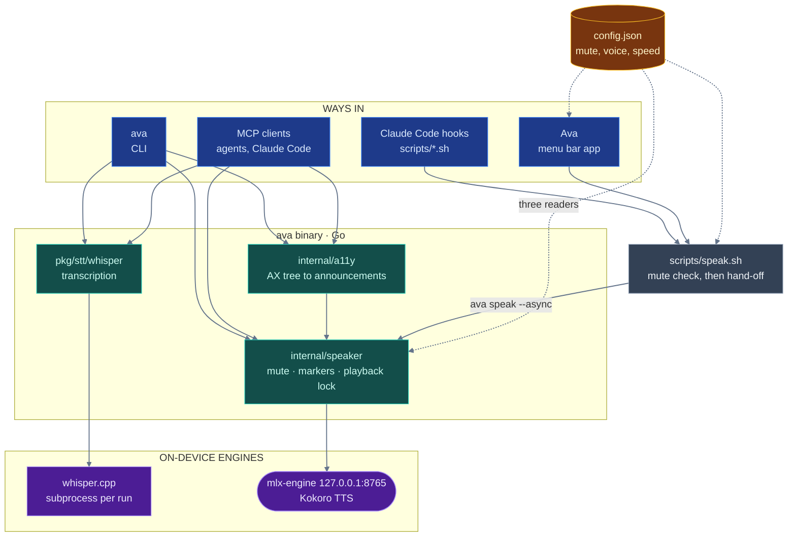

# Architecture

[← Back to the README](../README.md)

This is the map for someone changing the code. For using `ava`, start at the README. For the Kokoro server's HTTP contract, see [`engine-api.md`](engine-api.md).

## Bird's-eye view

`ava` is one Go binary with four ways in (the CLI, `ava mcp`, the Claude Code hooks and the menu bar app) and two on-device engines. whisper.cpp transcribes, as a subprocess per run. Kokoro speaks, from a local server (`mlx-engine/`) on `127.0.0.1:8765`. Every way in reads the same config file, and everything that speaks goes through one Go implementation.

`ava monitor` is not in the picture. It shares none of these paths: it streams through Voxtral (`voxtral/`), speaks nothing, and serves its transcript on `127.0.0.1:8766`. See [`monitor.md`](monitor.md) and [`voxtral-architecture.mmd`](voxtral-architecture.mmd).

## Code map

| Path | What it owns |
|---|---|
| `cmd/ava/` | The cobra command tree. Wiring only: each verb is a file with a `newXCmd()` constructor, and `mcp.go` serves the same capabilities as the verbs. `setup*.go`, `engine.go` and `update.go` install and run what the binary needs. |
| `internal/speaker/` | The only speak implementation: mute check, activity marker, playback lock, Kokoro synthesis, fallback to `say`. |
| `internal/ttscontrol/` | Cancels speech in flight, and reaps stale markers (`ReapStale`). |
| `internal/ttsproto/`, `internal/protocol/` | The cross-process constants. `protocol` is generated from `protocol.json`; `ttsproto` re-exports them under the names the Go packages use. |
| `internal/voiceconfig/` | The Go reader of the config file. |
| `internal/a11y/` | Turns a chrome-devtools accessibility snapshot into announcements. Pure functions. |
| `internal/enginedist/` | The mlx-engine bundle embedded in the binary. |
| `internal/selfupdate/` | `ava update`. |
| `internal/monitor/`, `internal/recording/`, `internal/clipboard/` | `ava monitor`, sox capture, and paste. macOS-specific. |
| `internal/archtest/` | The import rules, as a test. |
| `pkg/stt/`, `pkg/stt/whisper/`, `pkg/stt/captions/` | The transcription client shape, the whisper-cli wrapper, and SRT/WebVTT/JSON rendering. |
| `pkg/mlx/` | The HTTP client for the Kokoro server. |
| `mlx-engine/` | The Kokoro server (Python, `uv`). |
| `scripts/` | The hooks (`hook-stop.sh`, `hook-notify.sh`), `speak.sh`, `lib.sh` (the bash config reader), setup and the checks. |
| `AvaMenuBar/` | The menu bar app (Swift). |

## Invariants

### Hooks speak through the Go binary

`scripts/speak.sh` does a mute check and hands off to `ava speak --async`; it synthesizes and plays nothing itself. With one implementation there is no second player whose stop handling can drift from the first. The cost is that the hooks need `ava` built (`make build`) or installed, and `speak.sh` says so when it is missing.

### One config file, three readers

`~/Library/Application Support/ava/config.json` is parsed independently by Go (`internal/voiceconfig`), bash (`scripts/lib.sh`, for the hooks' mute and the engine auto-start only) and Swift (`VoiceSettings.swift`). Each runs where the others cannot, so the readers must agree on every input, malformed ones included. `internal/voiceconfig/contract_test.go` runs the Go and bash readers against the shared cases in `testdata/voice-config-cases.json`; `make check-swift-config` runs the Swift reader against the same cases. Add a case there before changing any reader.

### Speech is a cross-process protocol

Every process that speaks (the CLI, the MCP server, the hooks and the menu bar through `speak.sh`) follows the same three rules, because the menu bar's indicator and every stop path depend on them:

- The global mute is checked before anything is synthesized.
- An activity marker in `/tmp/ava-tts-active` exists for the whole synthesis and playback window.
- Playback holds an exclusive `flock(2)` on `/tmp/ava-tts-playback.lock`, so concurrent speaks queue instead of overlapping.

A speak killed with SIGKILL cannot remove its marker, so markers whose owning process is gone are reaped on the next stop or speak (`ReapStale` in `internal/ttscontrol`). `internal/speaker`'s package comment has the details.

### One source for shared constants

`internal/protocol/protocol.json` holds every value that more than one language must agree on: the activity directory, the playback lock, the sidecar suffixes, mlx-engine's URL, protocol version and pid file, the temp dir, and the env overrides for the first two paths. `make generate-protocol` renders it into `internal/protocol/protocol_gen.go`, `scripts/protocol.sh`, `AvaMenuBar/Sources/AvaMenuBar/Protocol.swift` and `mlx-engine/protocol.py`. All four are committed and none is edited by hand.

The values are generated rather than read from one file at runtime because the runtimes share no reachable path: `go:embed` cannot leave its package, an installed `ava` has no `scripts/`, and the menu bar app ships only its bundle. Two checks hold it: `make check-protocol` fails on a stale generated file, and `internal/protocol/contract_test.go` fails when a protocol value is spelled by hand outside one.

One consumer is not generated: `mlx-engine/Makefile` passes `--port 8765` to uvicorn. `TestPortAgreesAcrossEveryRuntimeThatSpellsIt` in `pkg/mlx` pins it instead.

### The engine bundle is embedded in the binary

`internal/enginedist` embeds what the engine needs to run: `mlx-engine/` (`server.py`, `protocol.py`, `pyproject.toml`, `uv.lock`, `.python-version`) and the scripts it sources (`mlx-engine-server.sh`, `lib.sh`, `protocol.sh`, `voice-defaults.json`). `ava setup` can then install Kokoro with no checkout. About 600 KB travels in the binary; the roughly 1.2 GB Python environment is resolved by `uv` at install time.

`make generate-enginedist` copies the canonical files into `internal/enginedist/files`, and `make check-enginedist` fails when a copy is stale. The generator enumerates `mlx-engine/` instead of listing files, so a new file cannot be left out. The embed pattern is `all:files`, because a plain `files` skips dot-prefixed entries such as `.python-version`.

### The checks that hold it together

`make lint` runs `go vet`, the format checks, `ruff check`, `check-protocol`, `check-enginedist` and three scripts:

- `make check-paths` (`scripts/check-portable-paths.sh`) fails on a hardcoded `/Users/<name>` in any tracked file.
- `make check-names` (`scripts/check-filenames.sh`) fails on a tracked filename that breaks another checkout: a character outside `A-Za-z0-9._-`, a leading dash, a Windows reserved name, or two paths that differ only by case. Every other check reads file contents, so none would catch this.
- `make check-docs` (`scripts/check-doc-coverage.sh`) fails when a Makefile target or a `scripts/*.sh` is mentioned in no markdown file.

`make check-swift-config` is outside `make lint` and `make test` because it needs `swiftc`.

### What may import what

The layers are the engines (out of process), then the core library (`pkg/` and `internal/speaker`, `internal/voiceconfig`, `internal/a11y`), then the adapters in `cmd/`. Core never imports an adapter, and a library consumer must not pay for the CLI or MCP framework. `internal/a11y` does no I/O.

`internal/archtest/rules.go` holds this as a rules table, checked against `go list -deps` by an ordinary test, so `go test ./...` and the pre-commit gate enforce it. A failure names the rule, the package and the import chain. A rule that matches no package also fails, so a rename cannot leave it checking nothing. Test-only imports are not in the graph. To change a rule, edit `rules.go` and prove it can still fail by adding the forbidden import on purpose.

## Environment variables

Every variable the code reads. Most are test hooks that point a reader at a throwaway path; nothing in normal operation sets them.

| Variable | Read by | Does |
|---|---|---|
| `TTS_SPEED`, `TTS_VOLUME`, `TTS_SAY_RATE` | `internal/voiceconfig` (so `speak.sh` too, through `ava speak`) | Override the configured speed, volume and `say` rate for one run. See [the hooks doc](claude-code-voice-hooks.md#settings) |
| `TTS_NOTIFY_MAX_CHARS`, `TTS_STOP_MAX_CHARS` | `scripts/hook-notify.sh`, `scripts/hook-stop.sh` | Override the spoken-length caps |
| `MLX_ENGINE_SCRIPT` | `internal/enginedist` (`ScriptEnv`) | Control script that `speak`'s implicit auto-start runs. See [the CLI reference](cli.md#engine-server) |
| `AVA_ENGINE_DIR` | `internal/enginedist` | Where `ava setup` installs the engine bundle, and where auto-start looks for it |
| `AVA_DOWNLOAD_BASE` | `cmd/ava/update.go` | Base URL `ava update` fetches `checksums.txt` and the archives from, instead of the GitHub release; `--source` wins over it |
| `AVA_BIN` | `scripts/install.sh` | Install directory, default `~/.local/bin` |
| `MLX_ENGINE_PID_FILE` | `mlx-engine/server.py` | The pid file the server removes on idle exit. `scripts/mlx-engine-server.sh` sets it so the two cannot disagree; also a test hook |
| `VOICECONFIG_PATH` | `internal/voiceconfig` | Test hook: the config file the Go reader loads |
| `VOICE_CONFIG_FILE`, `VOICE_DEFAULTS_FILE` | `scripts/lib.sh` | Test hook: the config and defaults files the bash reader loads, so the contract test can hand both readers the same fixture |
| `AVA_ENGINE_PID_FILE`, `AVA_ENGINE_LOG`, `AVA_ENGINE_LOCKDIR`, `AVA_ENGINE_URL` | `scripts/mlx-engine-server.sh` | Test hook: throwaway pid file, log, start lock and URL, so the engine-script tests in `cmd/ava/engine_script_test.go` never touch the real engine |
| `TTSCONTROL_ACTIVITY_DIR` | `internal/ttsproto`, `scripts/stop-speaking.sh` | Test hook: the speech activity-marker directory. Every reader honours it, the menu bar app included |
| `AVA_PLAYBACK_LOCK` | `internal/ttsproto` | Test hook: the playback lock, so a test that really plays does not queue behind speech on the machine |

The test suites also set a few variables (`AFPLAY_LOG`, `SOX_LOG`,
`WHISPER_LOG` and similar) that only their stub binaries read.
